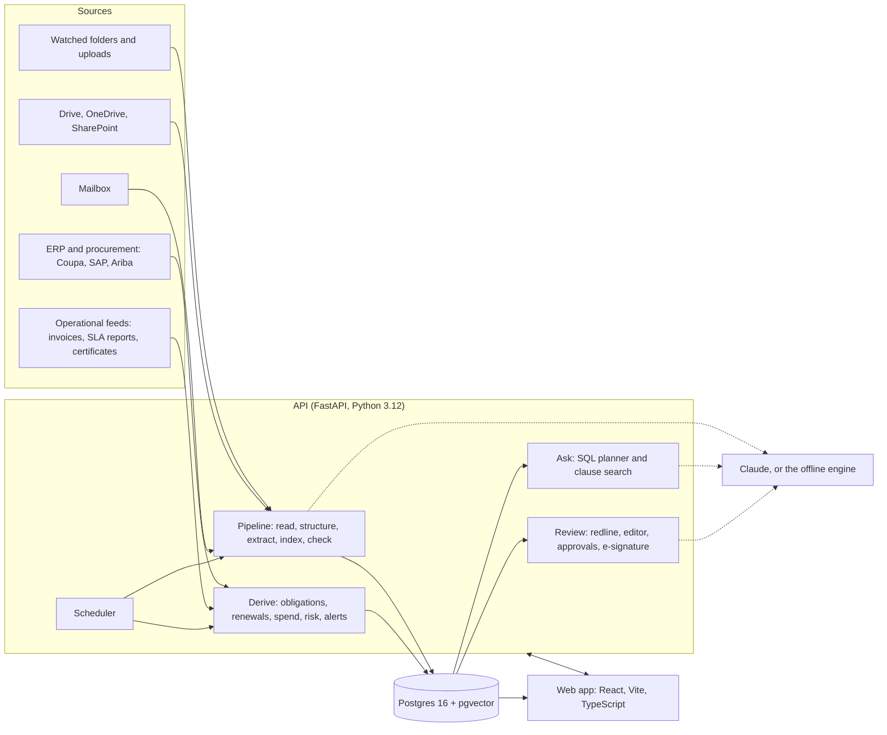

# Architecture

ContractIQ turns contract documents into structured, linked data, and every screen, rule, alert
and answer is computed from that data. This page describes the parts and how they fit together.
The document pipeline has its own page (`docs/PIPELINE.md`), as does the data model
(`docs/DATA_MODEL.md`).

## The system at a glance

Three containers run it (`docker-compose.yml`): `db` (Postgres 16 with pgvector), `api` (FastAPI
under uvicorn, which also runs the scheduler) and `web` (the Vite dev server for the React app).
One database holds everything, relational terms and clause vectors alike, so a question can join
terms, clauses and operational data in one query.

## Principles that shape the code

- **One dataset.** The pipeline writes documents, clauses, extracted fields, values, checks and
  deviations into the same tables that every screen and the Ask assistant read. Modules do not keep
  their own copies.
- **Every value has a source.** Extracted fields keep their confidence, source clause and page;
  effective terms keep the document each value comes from; Ask shows its SQL and cited clauses.
- **Configuration, not code.** What to identify, extract, check, alert on and approve is stored in
  tables and edited in Admin. Saving a rule re-derives results from the stored text without
  re-reading documents.
- **Works without Claude.** Every AI step has an offline counterpart (rules, a local embedding
  model, a question planner), used in Demo mode and as the fallback in Live mode.
- **Idempotent and incremental.** Documents are identified by the SHA-256 of their content; a run
  touches only what changed.
- **Read-only questions.** Ask's SQL runs as a SELECT-only database role with a statement timeout
  and a row limit, on views scoped to the user's property when the account is limited to one.

## Backend modules (`backend/app/`)

**Entry and cross-cutting**

| Module | Role |
|---|---|
| `main.py` | FastAPI app: middleware (auth, security headers, request ids, no-store), routers, simulators, startup (scheduler) |
| `config.py`, `db.py`, `models.py` | settings from the environment; SQLAlchemy engine and sessions; ORM models for the core tables (the schema itself is owned by Alembic) |
| `mode.py` | the Demo / Live switch |
| `llm.py`, `agent.py` | Claude wrapper with disk cache and call logging; Ask through the Claude Code Agent SDK |
| `embeddings.py` | fastembed (BGE-small), sentence-transformers, or a hashed bag of words |
| `scheduler.py` | periodic, on-change and manual pipeline triggers; alert evaluation |
| `auth.py`, `mfa.py`, `scope.py` | accounts, sessions, API tokens, OIDC; TOTP; limiting a request to one property |
| `retention.py`, `viewsql.py` | retention of audit and alert rows; SQL of the reporting views |

**Reading documents (the pipeline)**

| Module | Role |
|---|---|
| `pipeline.py` | scan folders, hash, ingest each file, link parents, record runs and events, live progress |
| `docstruct.py`, `ingest_text.py`, `parsing.py` | PDF, Word, HTML, Markdown and text to Markdown with page markers (OCR for scans); split into clauses |
| `kcc.py`, `kcc_ai.py` | the key-clause library: classify clauses by heading, keywords and sentences; optional Claude tagging |
| `meta_rules.py` | counterparty, document type, parent agreement, title |
| `extraction.py`, `extract_rules.py`, `textutil.py` | field extraction: Claude with a forced tool call, or rules over normalised text |
| `deviations.py` | compare clauses with the standard template and playbook |
| `recorded.py` | replay recorded results for the sample documents in Demo mode |
| `opsdocs.py`, `feeds.py` | operational documents and CSV feeds: invoices, SLA measurements, certificates, obligation updates |

**What the data drives**

| Module | Role |
|---|---|
| `obligations.py`, `certificates.py`, `onsite.py` | duties with dates and targets; required certificates; service calls and contacts at a property |
| `spend.py`, `risk.py`, `alerts.py` | invoices against contracts; vendor risk scorecards; alert rules and delivery |
| `properties.py`, `hotel_pack.py` | properties as records and what is contracted at each; the hospitality configuration pack |
| `ask.py`, `ask_nl.py`, `ask_modules.py`, `ask_scripted.py`, `ask_present.py`, `chat.py` | Ask: the Claude tool-use loop, the offline question planner, module answers, presentation of results, streamed conversations |
| `generator.py`, `brief.py` | new contracts from templates; deal details into template inputs |
| `docx_export.py`, `docx_comments.py`, `collab.py`, `esign.py` | Word export with tracked changes and comments; live collaboration; e-signature |
| `config_items.py` | configurable thresholds, risk points and SLA credit tiers |

**API routers:** `routes.py` (contracts, dashboard, renewals, Ask, templates, redline),
`routes_admin.py`, `routes_docs.py` (editor and review queue), `routes_chat.py`,
`routes_comments.py`, `routes_approvals.py`, `routes_signatures.py`, `routes_connectors.py`,
`routes_alerts.py`, `routes_auth.py`, `routes_scim.py`, `routes_quality.py`, `routes_vmo.py`
(obligations, SLA, spend, risk, benchmarks, feeds) and `routes_hotel.py` (properties, compare,
certificates, My hotel). Every endpoint is listed in `docs/reference/API.md`.

**Connectors and simulators:** `connectors/` holds Google Drive, Microsoft Graph (OneDrive and
SharePoint), mailbox (IMAP) and REST/OData procurement connectors, with secrets encrypted by
`connectors/crypto.py`. `simulators/` holds stand-ins with the same API shapes (cloud drives, ERP,
DocuSign, IMAP and SMTP, an OpenID Connect provider), mounted under `/sim` only with
`SIMULATORS=1`.

**Document generation:** `docgen/` writes the fictional corpora and their ground truth
(`specs.py`, `pilot_spec.py`, `hotel_spec.py`, `library.py`, `hotel_house.py`) used by `seed.py`
and the evaluations.

**Prompts:** `prompts/*.md`, kept as files so they can be reviewed.

## Frontend (`frontend/src/`)

React 18, TypeScript, Vite, Tailwind, TanStack Query for data, Recharts for charts. `main.tsx`
holds the routes, `ui.tsx` the shell (left rail, property picker, Demo/Live switch), `lib.ts` the
fetch helper (`api()`) and formatting, `forms.tsx` shared form controls. Each screen is one file in `pages/`:

| Screen | File | Main API |
|---|---|---|
| Portfolio (overview) | `Dashboard.tsx` | `/api/dashboard`, `/api/obligations`, `/api/spend/summary`, `/api/risk/vendors` |
| My hotel | `MyProperty.tsx` | `/api/my-property`, `/api/service-events`, `/api/vendor-contacts` |
| Portfolio map | `PortfolioMap.tsx` | `/api/portfolio-map` |
| Properties, Compare | `Properties.tsx`, `Compare.tsx` | `/api/properties`, `/api/properties/compare` |
| Renewals | `Renewals.tsx` | `/api/renewals`, `/api/renewals/decisions` |
| Contracts, contract detail | `Contracts.tsx`, `ContractDetail.tsx` | `/api/contracts` |
| Vendors | `Vendors.tsx`, `VendorProfile.tsx` | `/api/vendors` |
| Key clauses | `Clauses.tsx` | `/api/clause-matrix` |
| Ask | `Ask.tsx` | `/api/chat`, `/api/ask`, `/api/documents` |
| Redline, editor | `Redline.tsx`, `DocumentEditor.tsx` | `/api/redline`, `/api/documents` |
| Templates, new contract | `Templates.tsx`, `NewContract.tsx` | `/api/templates`, `/api/generator` |
| Obligations and SLAs, Spend, Risk | `Obligations.tsx`, `Spend.tsx`, `Risk.tsx` | `/api/obligations`, `/api/sla`, `/api/spend`, `/api/risk`, `/api/benchmarks` |
| Certificates, Alerts | `Certificates.tsx`, `Alerts.tsx` | `/api/certificates`, `/api/alerts` |
| Sign-in, security, shared and signing links | `Login.tsx`, `Security.tsx`, `Shared.tsx`, `Sign.tsx` | `/api/auth`, `/api/shared`, `/api/sign` |
| Admin (13 pages in three groups) | `pages/admin/*` | `/api/admin/*`, `/api/connectors`, `/api/users`, `/api/quality` |

Admin's groups: **Reading** (Pipeline, Key clauses, Values, Quality), **Rules** (Checklist,
Thresholds, Risk weights, Obligations, Approvals, Alerts) and **System** (Connectors, Access and
audit, AI usage).

## Ask: how a question is answered

1. The question, and the documents ticked (all by default), reach `/api/chat` (streamed) or
   `/api/ask`.
2. In Demo mode a recorded answer is used if the question and documents match one
   (`recorded.py`).
3. **Live:** Claude runs a tool-use loop (`ask.py`) with three tools: `run_sql` (SELECT only, on the
   read-only role `vmo_readonly`, whose `statement_timeout` is 5 seconds, at most 200 rows), `search_clauses` (pgvector similarity, with
   optional clause type and vendor) and `get_contract` (fields and effective terms). The system
   prompt describes the schema and views. A SQL error is fed back once for a retry.
4. **Offline:** `ask_nl.py` plans the question into SQL over the same views (aggregates, lists,
   group-by, hybrid clause-and-term questions) or a clause search; `ask_modules.py` answers module
   questions (obligations, SLA, spend, risk, alerts).
5. `ask_present.py` turns the tool calls into the answer, a result table, headline tiles and the
   steps shown under "How I got this", with links to cited clauses.

For a property-limited account, `scope.py` replaces every table and view with a temporary view of
that property's rows on the connection the query runs on.

## Security

Sign-in, roles (viewer, reviewer, admin), API tokens, OIDC single sign-on, SCIM provisioning, MFA,
audit log, encrypted secrets, share and signing links stored as hashes, and security headers. The
details, and what is not built (multi-tenancy, SOC 2), are in `docs/SECURITY.md`.

## Where to change things

| To change | Edit |
|---|---|
| What clauses are identified or required | Admin → Key clauses (table `kcc_library`); defaults in `kcc.py` and `hotel_pack.py` |
| A value read from contracts | Admin → Values (table `metrics`); extraction in `kcc.extract_metrics`, results in `extracted_values` |
| A field the pipeline extracts | `extraction.py` (schema and prompt in `prompts/`) and `extract_rules.py`; add the column by migration |
| A checklist rule | Admin → Checklist |
| A table or view | a new Alembic migration in `backend/alembic/versions/`; view SQL in `viewsql.py` |
| An endpoint | the matching `routes_*.py`; regenerate `docs/reference/API.md` |
| A screen | `frontend/src/pages/`, route in `main.tsx`, link in `ui.tsx` |
