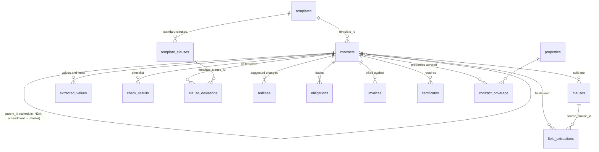

# Data model

One Postgres 16 database with the pgvector extension holds everything: the documents, what was
read from them, what was derived, the configuration that drives it, and the operational data it is
checked against. This page explains the main tables and how they connect. Every column, key and
index is listed in `docs/reference/DATABASE.md`, generated from the database.

The schema is owned by Alembic migrations (`backend/alembic/versions/`, 0001 to 0033). The
reporting views' SQL is in `backend/app/viewsql.py`, shared by the migrations that create and
recreate them.

## The core: a contract and what was read from it

**`contracts`**: one row per document (executed contracts, drafts and amendments alike). The key
terms are columns: `effective_date`, `expiry_date`, `notice_period_days`, `auto_renew`,
`annual_value`, `total_value`, `payment_terms_days`, `liability_cap_multiple` (NULL with a
`liability_cap_text` of unlimited means uncapped), `termination_for_convenience`, `governing_law`,
`processes_personal_data`, `has_dpa`, signatories and signing dates, `fully_executed`. Also its
`vendor`, `type` (MSA, SOW, Work Order, NDA, SaaS, DPA, Services, Amendment), `category`,
`property`, `status` (active, expired, draft), the full text as Markdown with page markers
(`body_md`), and where it came from: `source_path`, `content_hash` (SHA-256, the document's
identity), `source_size`, `source_mtime_ns`, `origin`, `ingested_at`.

- `parent_id` links a schedule, NDA or amendment to its master agreement.
- `overrides` (an amendment only) lists the terms it changes.

**`clauses`**: the document split into clauses: `clause_type` (from the key-clause library),
`heading`, `text`, `page`, and `embedding` (a 384-dimension vector for semantic search).

**`field_extractions`**: one row per extracted field: `value`, `confidence`, `source_clause_id`,
`source_page`, `corrected`. **`field_corrections`** keeps what a person corrected, by file, so it
survives re-reading.

**`extracted_values`**: the configurable values and limits read from clauses (response time,
insurance cover, rates), with clause and page. Defined by **`metrics`**.

**`check_results`**: each checklist rule's result for each contract (`pass`, `fail`, `na`), with
actual and expected values, severity, clause, page and excerpt. Defined by **`checklist_rules`**.

**`clause_deviations`** and **`redlines`**: differences from the standard template and playbook,
and for drafts the full list of suggested changes (`items` as JSON). Decisions on them are in
`redline_decisions`; review status in `contract_reviews`.

**`templates`** and **`template_clauses`**: the standard templates clause by clause, with the
playbook position, fallback wording and severity if missing.

**`obligations`**: duties derived from clauses and values (pay within N days, give notice by a date,
keep insurance, meet a response time), with party, due date, frequency, target and status.

## Properties

**`properties`**: one record per hotel (name, city, rooms, kind). **`contract_coverage`** records
exceptions to which properties a contract covers. The view `v_property_contracts` attributes every
contract to the properties it covers, with the basis and the share of a group agreement's value (by
rooms).

## Operational data

| Table | Holds | Comes from |
|---|---|---|
| `invoices` | invoices matched to contracts | ERP connectors, CSV feeds, invoice documents |
| `spend_exceptions` | off-contract, out-of-term, duplicate, above-rate and over-value invoices | `spend.py` |
| `sla_measurements` | monthly service-level actuals | feeds, service-level reports |
| `certificates` | certificates a vendor must hold and the expiry of the copy on file | clauses, feeds, certificate documents |
| `service_events`, `vendor_contacts` | service calls at a property; who to call | My hotel, feeds |
| `vendor_scores` | vendor risk scorecards | `risk.py`, weights in `risk_weights` |
| `renewal_decisions` | what was decided about a renewal | Renewals |
| `alerts` | raised alerts, with properties concerned | `alerts.py`, rules in `alert_rules` |

## Review, signing and collaboration

`document_versions` (edited versions), `comment_threads` and `comments` (anchored to text),
`share_links` (guest links, stored as hashes), `approvals` and `approval_steps` (chains chosen by
`approval_rules`), `signature_requests` and `signers` (e-signature), `sim_envelopes` (the DocuSign
simulator).

## Configuration (edited in Admin)

`kcc_library` (key clauses), `metrics` (values and limits), `checklist_rules`, `obligation_rules`,
`alert_rules`, `alert_channels`, `approval_rules`, `risk_weights`, `config_items` (thresholds, risk
points, SLA credit tiers), `pipeline_config` (pipelines, folders, triggers), `connectors`
(credentials encrypted), `app_settings` (including Demo mode).

## System

`pipeline_runs` and `pipeline_events` (every run and every file in it), `connector_files` (what a
connector synced), `llm_calls` (every Claude call: model, tokens, time, cost), `ask_cache` and
`kcc_ai_cache` (cached answers and tags), `users`, `api_tokens`, `audit_log`, `conversations` and
`chat_messages` (Ask history).

## Views: the business logic in SQL

The screens and Ask read views, so the rules live in one place.

| View | What it gives |
|---|---|
| `v_effective_terms` | one row per contract (amendments and drafts excluded) with amendments applied, and for each overridable term the id of the document it comes from (`*_source`); `liability_uncapped` |
| `v_document_terms` | the same shape, without applying amendments (each document's own terms) |
| `v_renewals` | `notice_deadline` (expiry minus notice period), days left, `notice_days_left`, bucket (`overdue`, `30`, `60`, `90`, `later`) |
| `v_property_contracts` | which contracts apply at each property, with basis and share of value |
| `v_key_clauses` | per contract, whether each key clause is present |
| `v_checks`, `v_deviations`, `v_values` | checklist results, deviations and values with contract details |
| `v_obligations` | duties with days left |
| `v_invoices`, `v_contract_spend`, `v_spend_exceptions` | invoices, billing against value over time, exceptions |
| `v_sla`, `v_sla_credit` | actuals against targets, breaches, estimated credits |
| `v_vendor_scores` | risk score and its components |
| `v_reviews` | the review queue |
| `v_alerts` | alerts with vendor and contract |

`v_effective_terms` is the one to understand: an amendment's overridden terms replace the
original's, the amendment with the latest effective date winning, and the `_source` columns record which document says so.
On the sample folder, the cleaning master agreement shows payment terms of 30 days from amendment
#57 where the original said 45, and its notice period of 90 days from itself (#54).

## Access for Ask

Migration 0001 creates the role `vmo_readonly` (SELECT only, `statement_timeout` 5 seconds). Ask's
`run_sql` uses it through `READONLY_DATABASE_URL`, wraps each query in `LIMIT 200`, and for a
property-limited user replaces every table and view with a temporary view of that property's rows
(`app/scope.py`). The schema description Claude is given is `backend/app/prompts/schema.md`.
